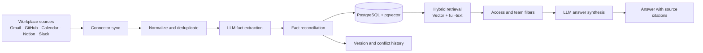

# Thread — AI Memory for Software Teams

Thread turns scattered team knowledge across workplace tools into **searchable, source-linked facts**. It helps teams answer questions like *“Why did we choose Postgres over DynamoDB?”* without digging through old emails, issues, documents, or chat threads.

Unlike a basic RAG chatbot, Thread extracts structured facts, tracks how they change over time, preserves decision history, and generates answers grounded in retrieved source facts.

> **Core idea:** Connect workplace knowledge, reconcile changing facts, and retrieve answers with provenance instead of treating every message as an isolated document chunk.

## Key capabilities

- **Connected knowledge ingestion:** Uses Composio-managed integrations for sources such as Gmail, GitHub, Google Calendar, Notion, and Slack.
- **Structured fact extraction:** Converts messages and documents into facts with source references, confidence information, team scope, and access controls.
- **Hybrid retrieval:** Combines semantic vector search with PostgreSQL full-text search and merges rankings using Reciprocal Rank Fusion (RRF).
- **Fact reconciliation:** Uses embedding-based candidate retrieval and an LLM judge to classify potential duplicates, superseded facts, contradictions, and unrelated information.
- **Versioned organizational memory:** Marks superseded facts as stale rather than deleting them, preserving historical decisions and changes.
- **Grounded answers:** Generates concise responses with citations to retrieved fact records and abstains when evidence is insufficient.
- **Multiple interfaces:** Includes a web UI and REST API, plus MCP, CLI, and Slack-facing interfaces in the codebase.

## How it works

1. **Ingest:** Connectors retrieve source content incrementally. Content hashes make repeated syncs idempotent.
2. **Extract:** An LLM turns relevant messages and documents into structured facts with source provenance and confidence information.
3. **Reconcile:** Existing candidate facts are compared with new facts to identify duplicates, updates, contradictions, or unrelated information. Superseded records remain available for historical queries.
4. **Retrieve:** Semantic search and PostgreSQL full-text search run together. RRF combines their rankings before access-control filtering.
5. **Answer and audit:** The system produces an evidence-grounded response with citations and records the query and returned fact references in an append-only ledger.

## Architecture and technology

| Layer | Implementation |
|---|---|
| API and application | Python, FastAPI |
| Database | PostgreSQL 16, Supabase, pgvector, PostgreSQL full-text search, Alembic migrations |
| Retrieval | Vector similarity, full-text search, Reciprocal Rank Fusion, access-control filtering |
| LLM orchestration | LiteLLM, Gemini models, OpenRouter fallback |
| Embeddings | Gemini `gemini-embedding-001` (768 dimensions), with configured fallback |
| Connectors | Composio-managed OAuth integrations |
| Authentication | Clerk-backed authentication with server-verified sessions |
| Hosted application | Vercel serverless deployment and Supabase PostgreSQL |
| Scheduled ingestion | GitHub Actions runs incremental sync every 15 minutes in the current hosted configuration |
| Observability and resilience | Prometheus metrics, error counters, token/cost accounting, retry handling, circuit breakers, graceful degradation |
| Development | Docker-supported local development; PostgreSQL with pgvector; Redis is optional for worker/cache paths |

The hosted sync uses a per-workspace, per-source checkpoint and advances it only after successful processing. Failed syncs record an error and retry with backoff instead of silently skipping the failed window.

The optional long-running worker and webhook path requires Redis and a persistent worker host. **It is not the current hosted ingestion path**; the hosted deployment uses scheduled one-shot syncs.

## Security and data isolation

- **Database-enforced tenant isolation:** PostgreSQL row-level security (RLS) protects tenant-scoped records alongside application-level authorization.
- **Fact-level access controls:** Facts carry team and visibility metadata; retrieval filters results according to the authenticated caller's permissions.
- **Server-derived identity:** Authorization uses the verified session rather than trusting a user ID supplied in a request body.
- **Secret handling:** Platform keys are loaded from environment variables. Customer-supplied LLM keys are encrypted at rest and are not returned by API responses.
- **Auditability:** Search requests record the query and the fact references returned, supporting investigation and review.
- **Safe failure behavior:** If answer synthesis is unavailable, the system can return ranked evidence rather than fabricate an answer; low-confidence queries can abstain.

## RAG evaluation

Thread includes repeatable evaluation and regression tooling for retrieval quality, answer correctness, grounding, citation support, refusal behavior, and fact-version reconciliation.

**The controlled benchmark results below come from a small labelled synthetic knowledge base. They are not production-scale accuracy claims.**

### Controlled retrieval and answer benchmark

Results pooled across three runs against a 44-fact corpus